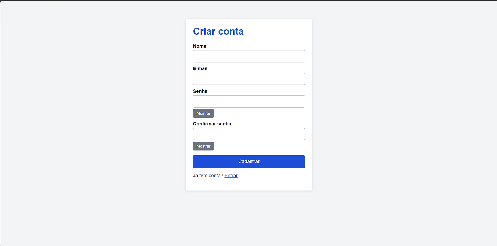
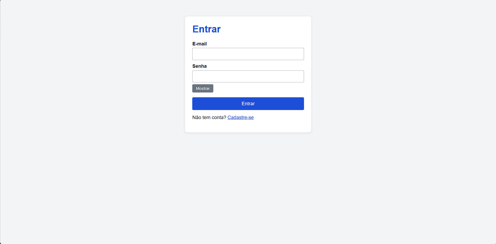
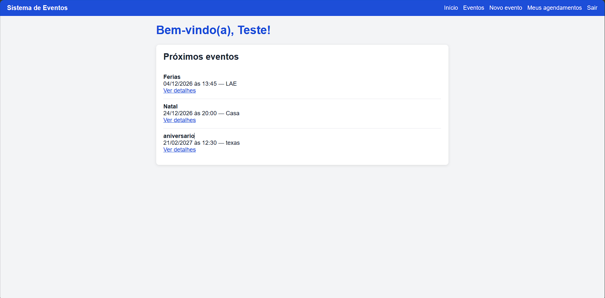
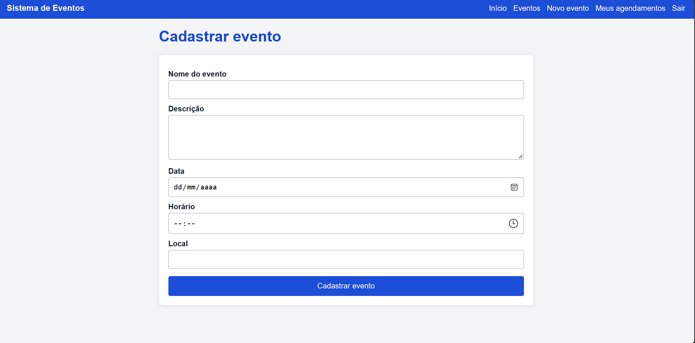
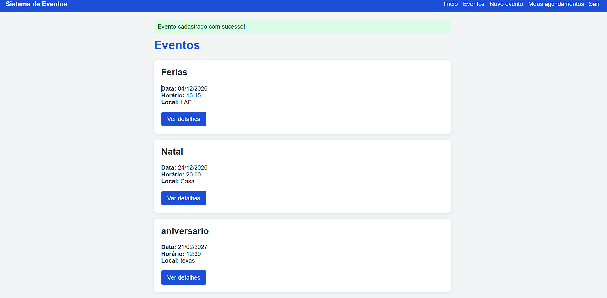
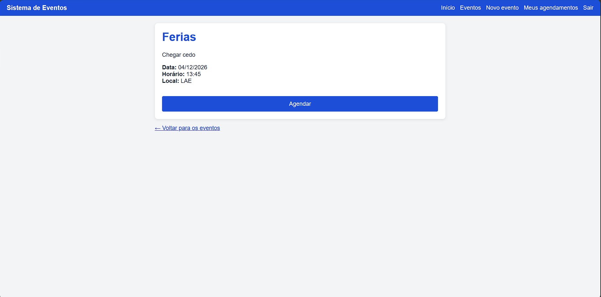
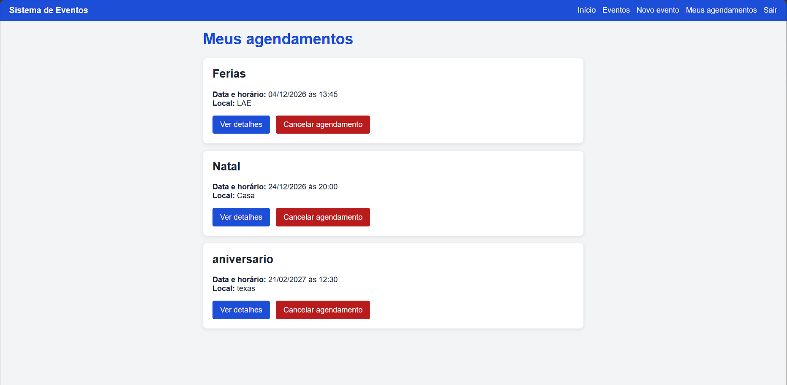

# Sistema de Agendamento de Eventos

Sistema web simples para cadastro e agendamento de eventos, desenvolvido como trabalho avaliativo da disciplina SIN 493 – Tópicos Especiais III: Introdução à Programação Web (UFV – Campus Rio Paranaíba).

O sistema permite criar uma conta, entrar, cadastrar eventos, consultar os detalhes, agendar e cancelar a participação.

## Integrantes
- Thiago Fernandes de Moraes
- Myrella Meireles Pereira Santos
- Júlia Marques Boaventura
- João Paulo Queiroz Nunes
- Gabriel Menezes
- Meishan Huang

## Tecnologias utilizadas
- HTML5
- CSS3
- JavaScript puro
- PHP puro
- Arquivos JSON para armazenamento dos dados (lidos e gravados pelo PHP)
- Git e GitHub

## Funcionalidades implementadas
- Cadastro de usuário, com validação em JavaScript e PHP e bloqueio de e-mail duplicado
- Login com e-mail e senha, usando sessão PHP, e opção de sair
- Senhas armazenadas com `password_hash()` e verificadas com `password_verify()`
- Páginas internas protegidas: só acessíveis com login
- Cadastro de eventos (nome, descrição, data, horário e local)
- Listagem de eventos e página de detalhes
- Agendamento em um evento, sem permitir agendar o mesmo evento duas vezes
- Página "Meus agendamentos", com cancelamento (com confirmação)
- Mensagens de sucesso e erro após as operações
- Botão para mostrar/ocultar a senha
- Layout adaptado para telas menores

## Como executar
1. Instale o PHP 8 ou superior (https://www.php.net/downloads).
2. Clone o repositório: `git clone https://github.com/Myrella669/sistema-eventos.git`
3. Entre na pasta do projeto: `cd sistema-eventos`
4. Inicie o servidor embutido do PHP: `php -S localhost:8000`
5. Abra http://localhost:8000 no navegador.

## Usuário de teste
Nenhuma conta vem pré-cadastrada. Para testar, abra a tela de cadastro (`/cadastro.php`), crie uma conta e entre com ela.

## Estrutura do projeto
- `css/estilo.css`: estilos
- `js/scripts.js`: validações e interações em JavaScript
- `dados/`: arquivos JSON (usuários, eventos e agendamentos)
- Arquivos `.php` na raiz: páginas e processamento do sistema

## Telas

### Cadastro

### Login

### Página inicial

### Cadastro de evento

### Eventos

### Detalhes do evento

### Meus agendamentos
